# Factory I/O – Pick and Place Otomasyonu

## Proje Hakkında

Bu çalışma, Siemens S7-1200 PLC, TIA Portal V18 ve Factory I/O kullanılarak gerçekleştirilen bir Pick and Place otomasyon uygulamasıdır.

Çalışmada, Factory I/O ortamındaki konveyörlü ürün taşıma ve transfer sisteminin kontrolü Ladder Diagram (LAD) programlama diliyle gerçekleştirilmiştir. PLC programı S7-PLCSIM üzerinden simüle edilerek Factory I/O ile haberleştirilmiştir.

Bu uygulama, PLC programlama, dijital giriş-çıkış yönetimi, sensör kontrolü, zamanlayıcılar, sayıcılar ve otomatik sıralı işlem mantığı üzerine yapılan bir eğitim ve pratik çalışmasıdır.

## Kullanılan Yazılım ve Teknolojiler

- Siemens S7-1200 PLC (CPU 1214C AC/DC/Rly)
- Siemens TIA Portal V18
- Siemens S7-PLCSIM
- Factory I/O
- Ladder Diagram (LAD)
- TON zamanlayıcıları
- Set/Reset (SR) mantığı
- Sensör ve aktüatör kontrolü
- Ürün sayma işlemleri

## Sistemin Çalışma Prensibi

1. START butonuyla sistem çalıştırılır.
2. Birinci konveyör ürünleri taşıyarak transfer alanına ulaştırır.
3. Ürün algılama sensörü, transfer edilecek ürünü tespit eder.
4. Pick and Place mekanizması ürünü tutarak kaldırma ve yatay taşıma işlemlerini gerçekleştirir.
5. Ürün ikinci konveyöre bırakılır ve transfer mekanizması başlangıç konumuna döner.
6. İkinci konveyör ürünü çıkış alanına taşır.
7. Transfer edilen ürünler sensör üzerinden sayılır.
8. Ürün sayısı belirlenen değere ulaştığında sistem otomatik olarak durdurulur.

Programda işlem adımlarının sıralanması için zamanlayıcılar, yardımcı bellek bitleri ve Set/Reset komutları kullanılmıştır. STOP, acil durdurma ve RESET işlevleri de kontrol mantığına dahil edilmiştir.

## PLC Programı – Ladder (LAD)

### Sistem Başlatma ve İlk Hareketler
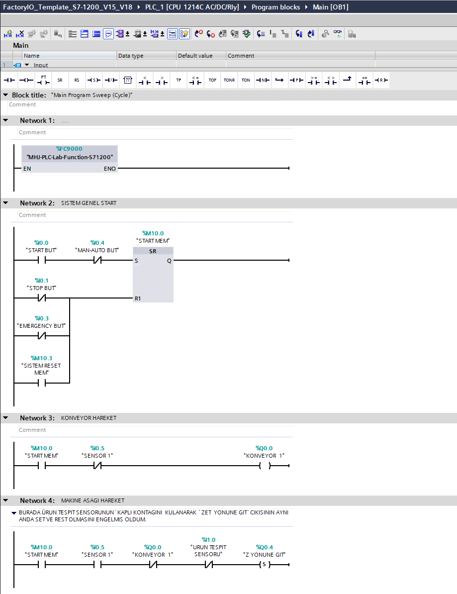

### Ürün Tutma ve Transfer Kontrolü
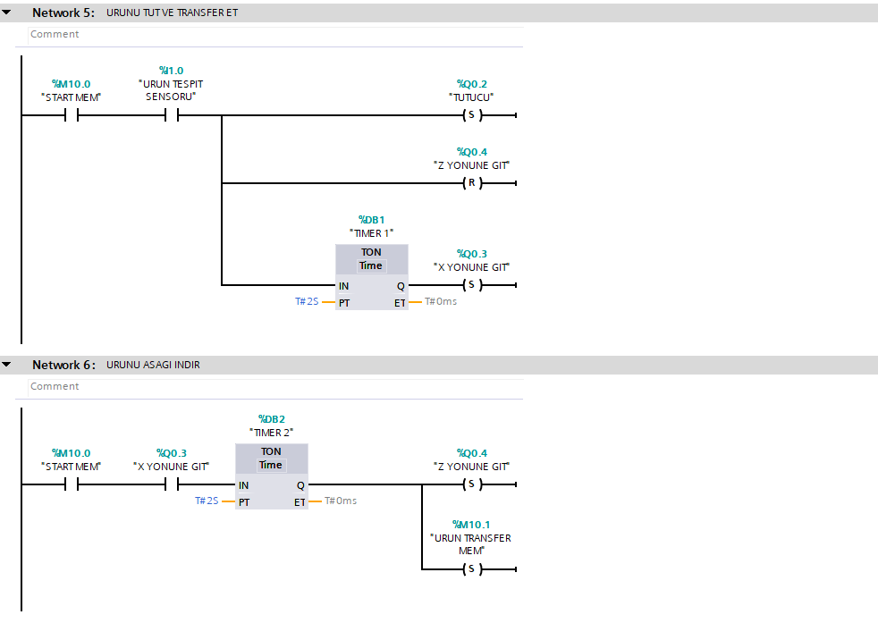

### Ürün Bırakma ve Konveyör Kontrolü
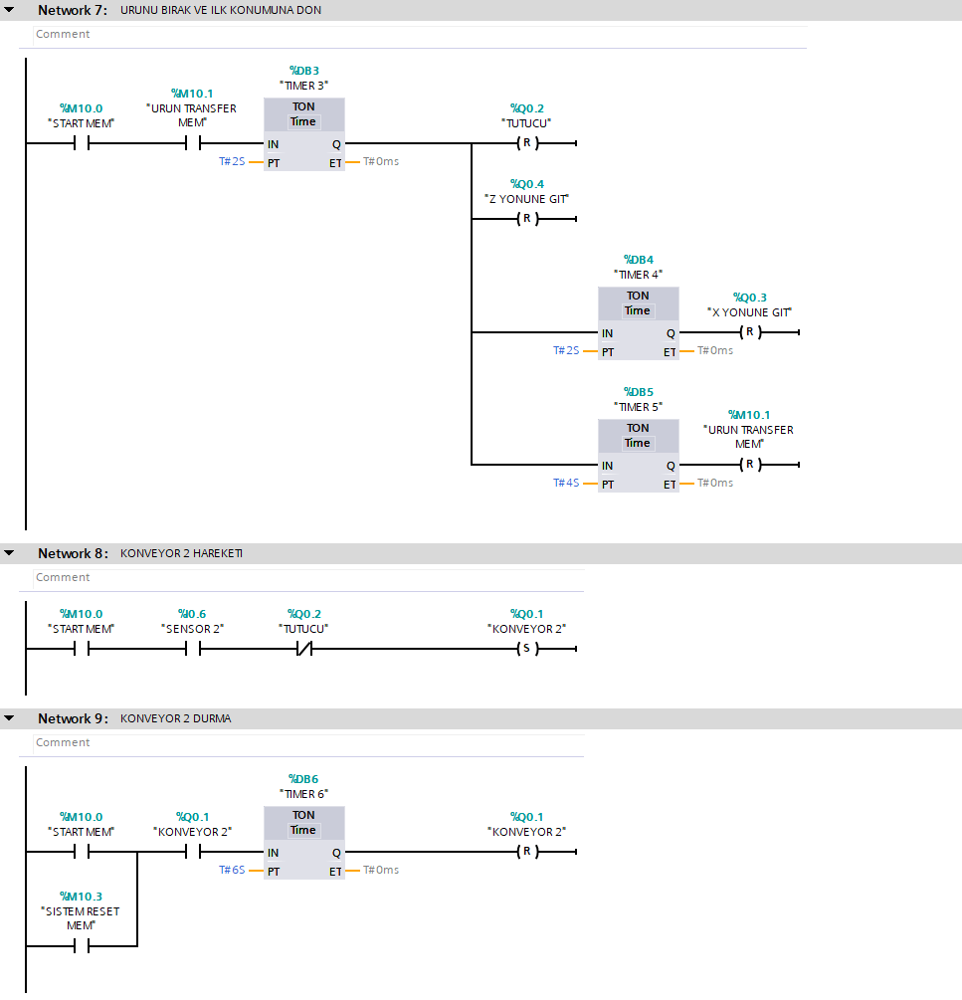

### Ürün Sayma ve Sistem Resetleme
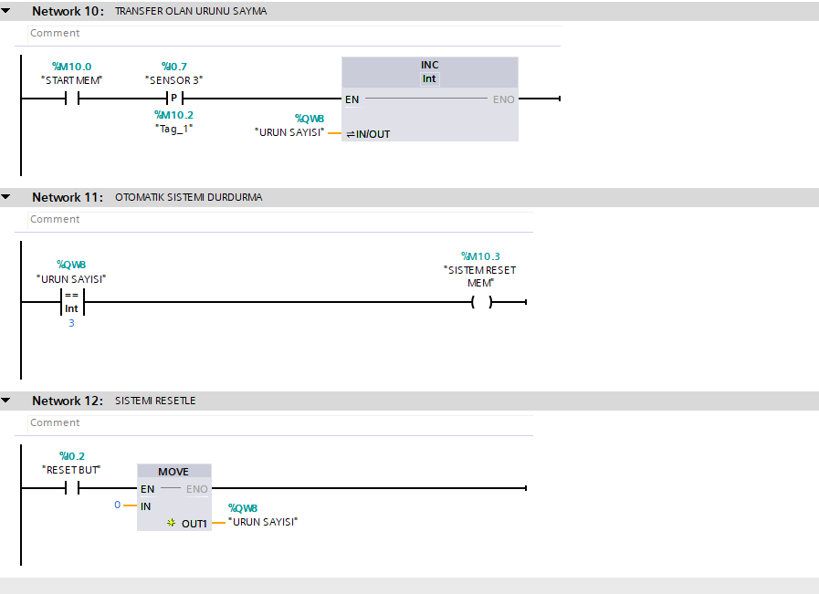

## PLC Giriş-Çıkış Adresleri

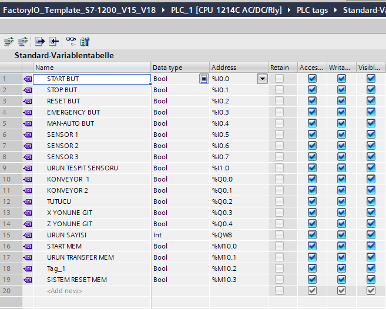

## Factory I/O – PLC Haberleşmesi

Factory I/O ile S7-PLCSIM arasındaki bağlantı Siemens S7-PLCSIM sürücüsü üzerinden gerçekleştirilmiştir. Sensörler PLC girişlerine, aktüatörler ise PLC çıkışlarına eşleştirilmiştir.

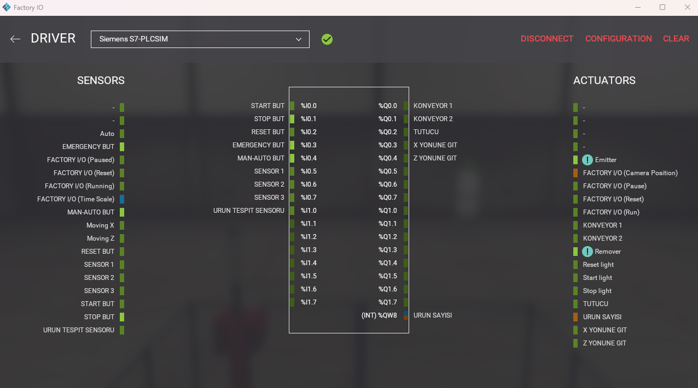

## Factory I/O Simülasyon Görselleri

### Sistemin Genel Görünümü
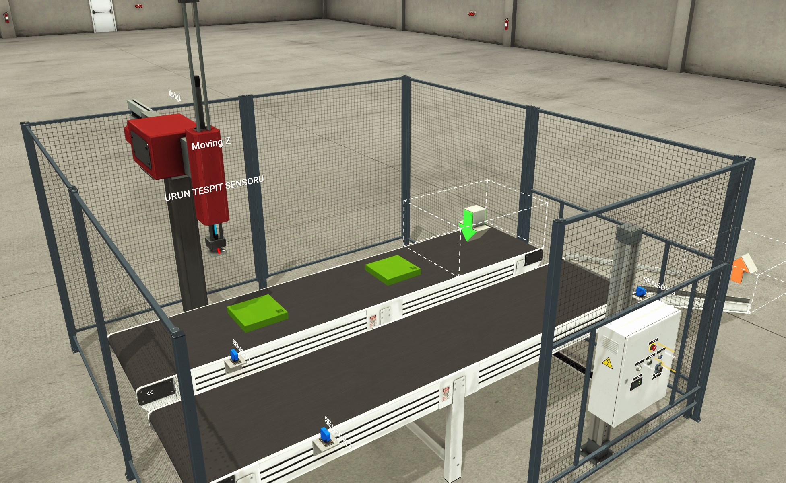

### Ürün Tutma ve Transfer İşlemi
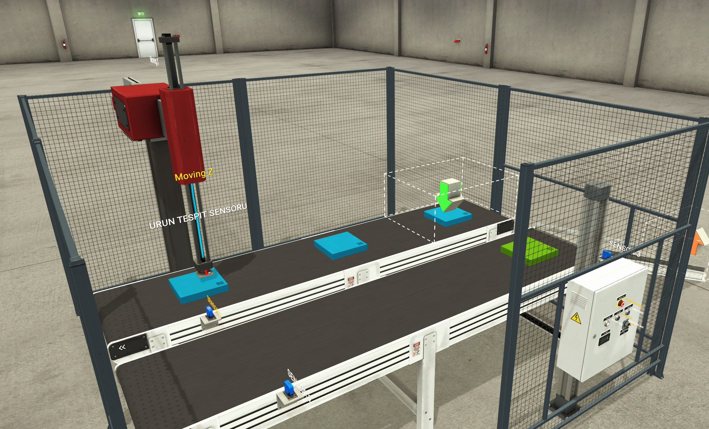

### Ürün Bırakma ve Konveyör
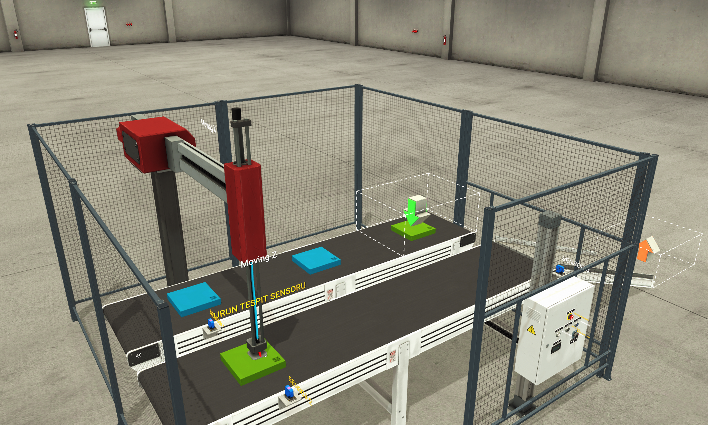

### Operatör Kontrol Paneli
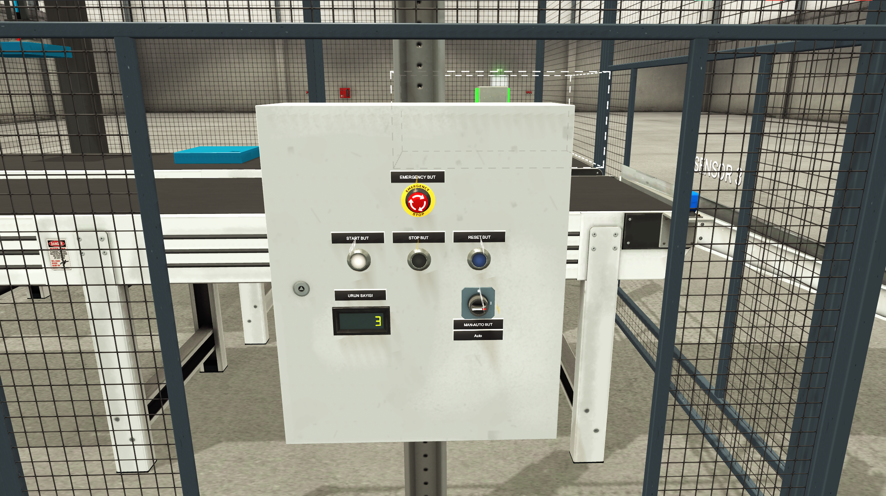

## TIA Portal Proje Dosyası

Depoda TIA Portal V18 proje arşivi (`.zap18`) bulunmaktadır. Proje, uygun TIA Portal sürümünde arşivden geri yüklenerek incelenebilir.

## Çalışmanın Kapsamı

Bu depo, PLC programlama ve endüstriyel otomasyon alanında edinilen bilgileri uygulamak amacıyla hazırlanmış bir eğitim ve pratik çalışmasını belgelemektedir.

Çalışmanın odak noktası, Factory I/O simülasyon ortamındaki sistem için Siemens S7-1200 PLC Ladder kontrol programının hazırlanması, giriş-çıkış eşleştirmelerinin yapılması ve S7-PLCSIM üzerinden çalışma mantığının test edilmesidir.

## PLC Online İzleme ve Simülasyon Testleri

Bu bölümde Siemens TIA Portal V18 üzerinde geliştirilen Ladder (LAD) programının S7-PLCSIM ile çevrim içi izlenmesine ait ekran görüntüleri yer almaktadır.

### Sistem Başlatma ve Konveyör Kontrolü

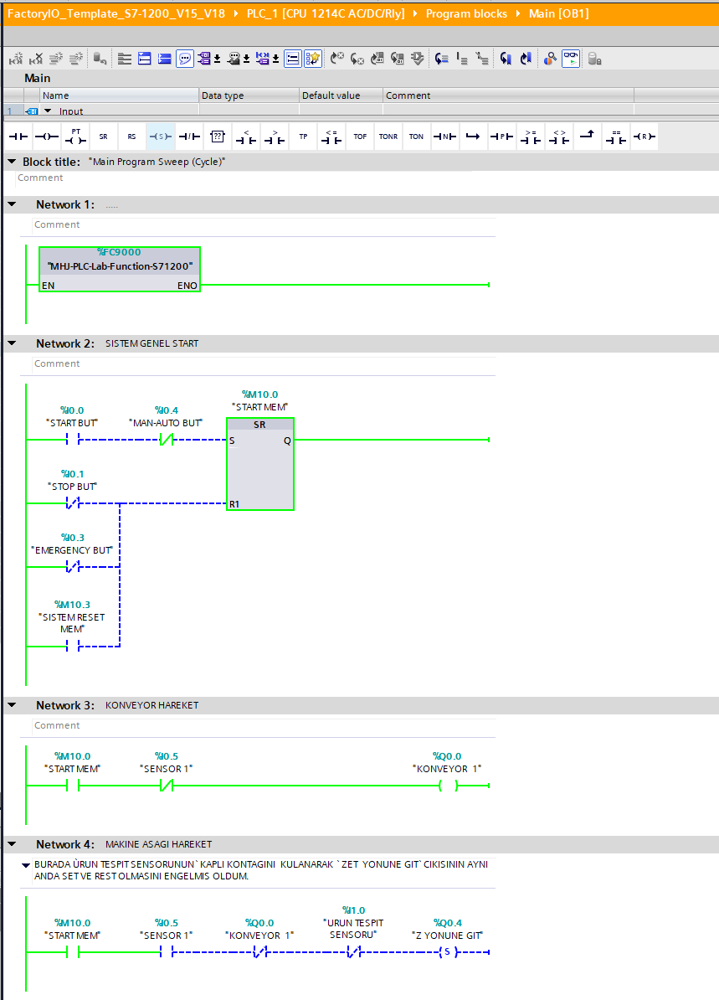

### Ürün Tutma ve Transfer Kontrolü

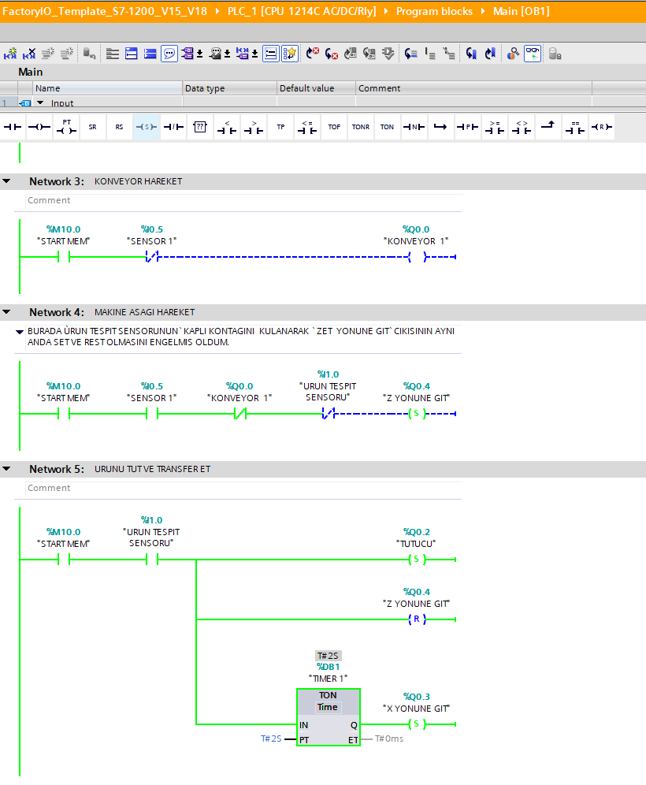
  

